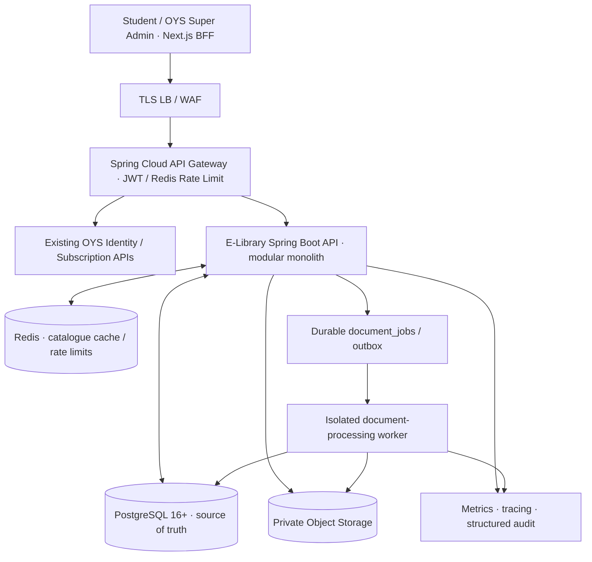

# v1.5 Addendum — System Design: Category Navigation and Pagination

**Current project addendum:** [06_CATEGORY_HIERARCHY_AND_PAGINATION.md](06_CATEGORY_HIERARCHY_AND_PAGINATION.md). Adopt **Sector → Category → optional Subcategory → Subject → Material** with V3 migration and safe bounded published-material paging; this supersedes the earlier direct `sectors → subjects` layout. Migration retains legacy subjects under a per-sector General category. The new catalogue API enforces active hierarchy and verified OYS `college_id` claim. Frontend screens remain sample-only until OYS login, college membership, and document integrations are available. The migration, Maven build and browser QA have **not** been verified at runtime here.

---

# OYS E-Library — High-Level & Logical System Design

**Version:** 1.3 · **Date:** 2026-11-16 · **Status:** design baseline, not production-certified

## 1. Goal / domain boundaries
The E-Library is an OYS module for B.Tech students of subscribed partner colleges and one OYS Super Admin. Reuse existing OYS identity and subscription systems. Never create a second login/password store. OYS owns `sub` (student ID), college membership, verified account state, role grants and subscription status. E-Library owns published learning content, reader state, progress, bookmarks and credit ledger.

Design assumptions requiring an explicit OYS interface contract: issuer + JWKS URL + audience, student/college ID canonical formats, authoritative role mappings, college membership updates, subscription-expiry semantics and revoke events. No auth bypass in dev or prod.

## 2. Architecture

**Data plane:** Gateway validates bearer tokens with OYS signing keys; E-Library validates them independently. For every read, use server-derived student and college identity plus current subscription/visibility/entitlement checks. **Control plane:** Super Admin creates sector/subject/material, uploads files, reviews generated TOC and eligible pages, then publishes immutable material version. Background document worker runs out-of-process with restricted permissions.

The **initial starter** includes the schema, backend skeleton, authenticated catalogue endpoint and UI concept. It does not claim that OYS auth integration, document conversion, or the credit engine is implemented.

## 3. Runtime boundaries
- **Frontend:** Next.js 16 App Router, TypeScript and responsive custom CSS; glassmorphism only on navigation/cards, with opaque reading surfaces. No remote image dependencies and no AI-generated placeholder art.
- **Gateway:** TLS, authentication/routing and differentiated rate limits (login through OYS, read, upload, redemption and heartbeats). Never trust spoofable user IDs in forwarded headers.
- **Identity:** OYS issuer signs JWT. Short-lived bearer access token; rotating HttpOnly Secure refresh cookie owned by OYS. Frontend BFF does not store tokens in browser localStorage. If browser cookies are used for mutations, enforce CSRF and Origin checks.
- **Core:** Catalogue, Content, Visibility, Progress, Bookmark, Reward, Trending, Admin and Audit modules in one transaction boundary.
- **Worker:** Malware scan, file-signature and DOCX ZIP safety checks, conversion in a sandbox (no network, minimal CPU/RAM, no macros), TOC extraction and page fingerprint generation, explicit admin review before publish.
- **Storage:** Private object keys referenced by `asset_objects`; only signed short-lived access or a backend authorized HTTP Range streaming endpoint, no public bucket.
- **Redis:** Cache published catalogue keys scoped by college/visibility version, rate-limit counters; never authoritative for credit balance, page completion or entitlements.
- **PostgreSQL:** Foreign keys and uniqueness as baseline; row locking and server authorization as application invariants. Multi-tenant isolation via application access policy; add explicit RLS roles if other app clients ever access DB directly.

## 4. Confirmed business policies
1. Four initial sectors: Engineering, IT, Private Jobs, Government Jobs. `sector -> subject -> material`.
2. Material access tier is FREE or PREMIUM; Trending is an independent ranked view with PIN/EXCLUDE admin override.
3. Read online only. PDF and DOCX normalized to safe PDF reader format; downloadable file prevention is best-effort UI, not DRM.
4. TOC automatically suggested, corrected and approved by admin; eligible pages exclude cover, TOC and non-learning pages.
5. A page requires >= 8s server-validated active view and an explicit mark-as-read action. Jump/scroll does not count. Fully completed if all eligible pages marked. Resume at last successfully marked page.
6. For each three **distinct** Free materials completed once per student: exactly one credit. Redeem one credit instantly for one Premium material. No duplicate reward for reread or revision.
7. Expired college subscription allows reading **existing** material, blocks new Premium redemption. Definition of existing material access needs OYS product sign-off; conservative proposal is recorded previously-started Free + already-unlocked Premium only.
8. One published material version is active at a time. Only confidently mapped unchanged pages can migrate progress; all ambiguous changes require admin review. Historic credits survive reclassification/archive.
9. College-specific visibility must be re-evaluated on every access, including previously unlocked material.

## 5. State machines
`material: DRAFT -> PROCESSING -> REVIEW_REQUIRED -> PUBLISHED -> ARCHIVED` (+ PROCESSING_FAILED). Edit after publish creates a new immutable version. `material_versions: UPLOADED -> QUEUED -> PROCESSING -> REVIEW_REQUIRED -> READY` (+ FAILED). Admin may publish only READY, scanned-clean reader copies with reviewed TOC/eligibility and a valid college visibility policy.

`page: NOT_READ -> VIEWING -> ELIGIBLE_TO_MARK -> COMPLETED`; navigating away does not mark page. Reader uses a single active page per student across tabs, TTL-expiring session and server-side bounded heartbeats. Not possible to prove genuine attention by a timer; it is an engagement minimum.

## 6. Business invariants / transaction boundaries
- `student_page_completions (student_id,page_id)` unique; mark-read is idempotent. Check page belongs to published authorized version and `is_eligible=true`.
- `qualifying_free_completions (student_id,material_id)` unique; a material earns credit only once even when later revised/reclassified.
- `student_reward_accounts` row is locked (`SELECT ... FOR UPDATE`) when qualifying Free completion or redeeming a credit. Award the Nth credit only as ordinal reaches multiples of 3. `earned_credits = floor(qualifying_count/3)`, `available = earned - redeemed` and nonnegative.
- `premium_unlock_requests (student_id,idempotency_key)` unique, checked for same material before returning a prior result; redeem once by locking wallet, validating subscription, tier and college, creating entitlement, inserting unique REDEEM ledger row and incrementing redeemed count in one transaction.
- Reads honor `student_material_access` grant history. A new grant must be created only when OYS says college active; policy for expired access is a final blocker.
- **Do not** accept `student_id`, `college_id`, role or credit balance from user-supplied payload as authority. All from OYS identity and server state.

## 7. Subscription and visibility authorization decision order
1. Verify JWT signature, expiry, issuer, audience and role; check OYS account active.
2. Get canonical student ID, current college and current subscription state through trusted OYS identity/entitlement integration (bounded cache with revocation strategy).
3. Verify material is PUBLISHED and belongs to enabled sector/subject.
4. Verify `ALL_COLLEGES` or restricted `material_college_visibility` entry.
5. For FREE: allow active-subscription new access; while expired, allow only an existing access grant (tentative rule). For PREMIUM: require entitlement; prohibit new unlock when expired.
6. Serve permitted page ranges through authorized proxy or short-lived signed URLs; re-check on each new token issuance.

## 8. Reader design
PDF.js with an independent TOC sidebar, central reading canvas and right progress/bookmark rail on desktop; stacked layout on mobile. Track page as an immutable `material_pages.id`, not raw physical page number alone; persist resume position as last-marked page ID. Reading timer pauses when hidden or inactive. Heartbeat is untrusted input, so backend clamps delta based on server receipt time and session TTL, with no rapid repeat counting.

## 9. Search and analytics
Start with PostgreSQL full-text GIN index for published metadata (never search raw private documents without an authorization-filtered index). Paginate with constrained maximum page size. Trending aggregates *unique students* rather than page hits, rank by 7-day engagement with Super Admin pin/exclusion. User identifiers in aggregate reporting must be minimized.

## 10. Availability and operational concerns
Health checks and stateless instances behind LB. Daily PostgreSQL backups with periodic restore drills. Immutable versioned S3 objects with scoped bucket permissions. Observability: request correlation IDs, alerting on unusual redemption/heartbeat errors, gateway 4xx/5xx, processing jobs, migrations and DB pool saturation. Durable worker jobs with retry limit and quarantine.

## 11. Scale and performance targets (proposed; not promised)
- Initial design review targets: catalogue p95 < 500 ms at modest partner-college load; reader metadata p95 < 400 ms excluding file transfer; zero wallet overdrafts under concurrent redemption.
- No real traffic model yet: concurrent students, average pages and file sizes, number of partner colleges, RPO/RTO and peak throughput must be supplied for sizing.

## 12. Security rules
Threat-model STRIDE + OWASP ASVS/Top 10 with primary focus on BOLA/IDOR, document parser execution, SSRF/XXE/ZIP bombs, cross-origin token leakage, XSS via descriptions/TOC, prompt injection from uploaded content, token audience confusion, concurrency/double credit and unaudited admin actions. No generative AI execution in first release; automatic TOC suggestions use deterministic parsers/heuristics. Any future LLM ingestion must isolate untrusted document text as data, with no tool authority or secrets.

## 13. Decisions still blocking full integration
- Exact OYS auth issuer/JWKS/audience/roles claims and how expired/revoked subscriptions are delivered.
- Meaning of "existing materials" after expiry (previously opened versus catalogue already published).
- Rights of students if Super Admin removes college visibility after a prior unlock.
- Production storage provider, max file size and total page limits, retention/deletion and copyright policy.
- Precise backend deployment/network policy and whether to expose a BFF rather than browser bearer token flow.

## 14. External references
- https://docs.spring.io/spring-security/reference/servlet/oauth2/resource-server/jwt.html
- https://docs.spring.io/spring-cloud-gateway/reference/spring-cloud-gateway-server-webflux/gatewayfilter-factories/requestratelimiter-factory.html
- https://cheatsheetseries.owasp.org/cheatsheets/Authorization_Cheat_Sheet.html
- https://cheatsheetseries.owasp.org/cheatsheets/File_Upload_Cheat_Sheet.html
- https://cheatsheetseries.owasp.org/cheatsheets/Nextjs_Security_Cheat_Sheet.html
